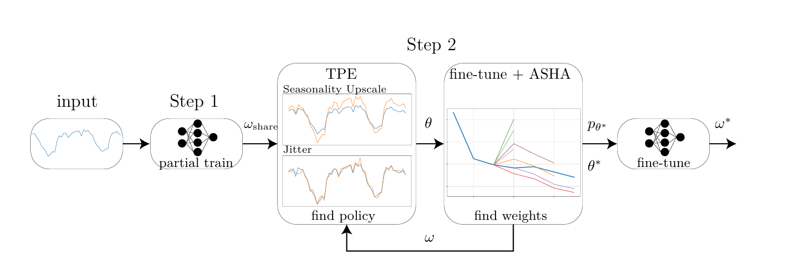
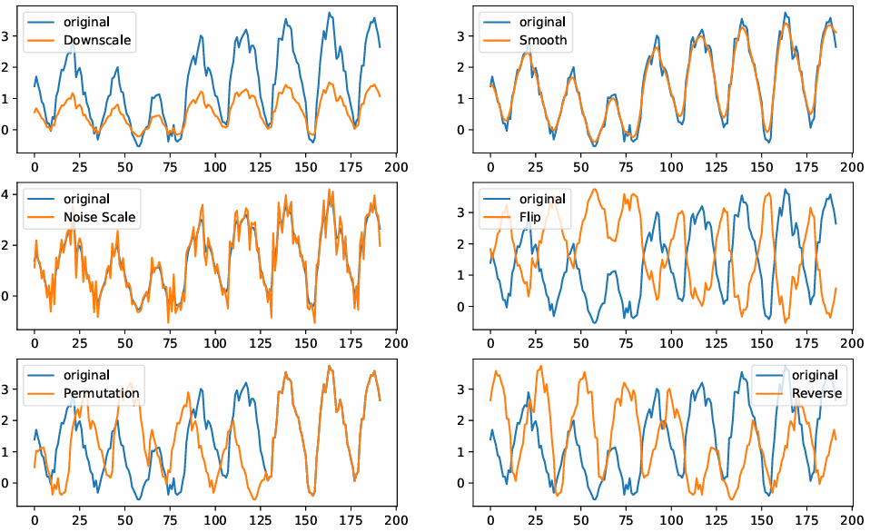

# Data Augmentation Policy Search for Long-Term Forecasting (Accepted TMLR 2025)


Official implementation of:
"[Data Augmentation Policy Search for Long-Term Forecasting](https://arxiv.org/abs/2405.00319)". 

## TL;DR

This paper introduces Time-Series Automatic Augmentation (TSAA), a novel framework designed to improve long-term time-series forecasting by automatically discovering effective data augmentation (DA) policies. While DA has been successful in domains like vision and NLP, time-series tasks remain underexplored due to their unique structure and dynamics. TSAA addresses this gap by combining a curated set of time-series transformations with Bayesian optimization (Tree-structured Parzen Estimator and Expected Improvement) for augmentation policy search and ASHA (Asynchronous Successive Halving) for efficient training. The framework is formulated as a bi-level optimization problem and is computationally streamlined by pretraining models to obtain shared weights, then fine-tuning under different DA policies. Evaluated on standard univariate and multivariate forecasting benchmarks, TSAA consistently improves performance across architectures, offering a principled and practical method for time-series data augmentation.



### Environment Requirements
```
conda create -n TSAA python=3.9
conda activate TSAA
pip install -r requirements.txt
```
Make sure to install also a suitable pytorch. Original implementation used the following version: 2.1.1+cu118

### Data Preparation

You can obtain all benchmarks from [Google Drive](https://drive.google.com/drive/folders/1ZOYpTUa82_jCcxIdTmyr0LXQfvaM9vIy) provided in Autoformer. All the datasets are well pre-processed and can be used easily.

```
mkdir dataset
```
**Please put them in the `./dataset` directory**

## Citing

If you find this repository useful for your work, please consider citing it as follows:

```BibTeX
@article{nochumsohn2024data,
  title={Data augmentation policy search for long-term forecasting},
  author={Nochumsohn, Liran and Azencot, Omri},
  journal={arXiv preprint arXiv:2405.00319},
  year={2024}
}
```

## Acknowledgement


This code is simply built on the code base of Autoformer. We appreciate the following GitHub repos a lot for their valuable code base or datasets:

Autoformer repo can be found at https://github.com/thuml/Autoformer


Please remember to cite all the datasets and compared methods if you use them in your experiments.
